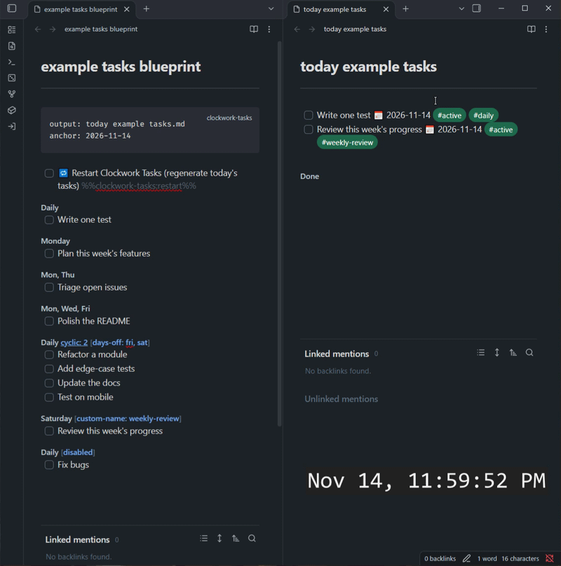
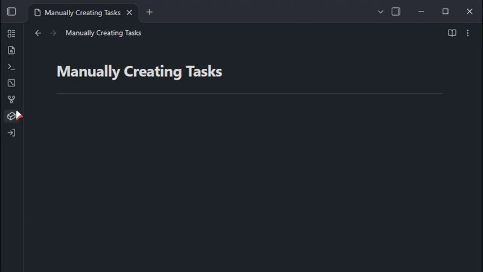

<p align="center">
  
</p>

<h1 align="center">Clockwork Tasks</h1>

<p align="center">
  <strong>Your recurring tasks, on schedule.</strong><br>
  Write your routines once as Markdown lists. Clockwork Tasks creates, rotates and tidies them every day, right inside Obsidian.
</p>

<p align="center">
  <a href="#usage">Usage</a> •
  <a href="#schedules-and-modifiers">Schedules</a> •
  <a href="#dates-and-the-due-date-menu">Dates</a> •
  <a href="#works-great-with-taskscape">Taskscape</a> •
  <a href="#installation">Installation</a>
</p>

***

Clockwork Tasks reads a **TaskFile**, an ordinary note where every `######` heading is a routine, and writes today's tasks into an **output note**. It is made for habits, chores and self-improvement lists: things that come back every day or every week, or that you want to rotate through one at a time.

<p align="center">
  
</p>

No other plugin required, However I recommend installing [Tasks](https://community.obsidian.md/plugins/obsidian-tasks-plugin) plugin as it really helps you organize.




### Usage

Add a `clockwork-tasks` code block to any note, then a `######` (level 6) heading for every routine:

````
```clockwork-tasks
output: TODO/Daily Tasks.md
```

###### Daily
- [ ] Drink water
- [ ] Read 10 pages

###### Daily [cyclic]
- [ ] Workout legs
- [ ] Workout back
- [ ] Workout chest

###### Saturday
- [ ] Clean the desk
````

Every day, Clockwork Tasks adds that day's tasks to `TODO/Daily Tasks.md`:

```
- [ ] Drink water 📅 2026-11-15 #active #daily
- [ ] Workout back 📅 2026-11-15 #active #daily-cyclic
```

Only `output` is required. The other lines are optional:

| Parameter | What it does | Default |
| --- | --- | --- |
| `output` | Note that receives the generated tasks (with or without `.md`) | required |
| `trigger` | When the day rolls over. Currently only `daily` is supported | `daily` |
| `anchor` | Start date (`YYYY-MM-DD`) that `[cyclic]` lists count from | set in the plugin settings |

**What happens each day**

- A day's tasks are created **once**, the first time the plugin runs that day: at startup, every few minutes, or right after midnight.
- Tasks are inserted just above the `###### Done` heading of the output note. A task that is already in the note, done or not, is never added twice.
- Completed tasks move under `###### Done`, newest first, and lose their `#active` tag.
- Unfinished tasks from earlier days lose `#active` too (you can turn this off), so `#active` always means "today".
- Several TaskFiles can feed the same output note.

#### Regenerate today's tasks

Clockwork Tasks adds a checkbox under the code block of every TaskFile:

```
- [ ] 🔁 Restart Clockwork Tasks (regenerate today's tasks) %%clockwork-tasks:restart%%
```

Tick it after editing a list and today's tasks are regenerated straight away. The plugin unticks it afterwards. The `%%...%%` part is an Obsidian comment, so it stays invisible when the note is rendered.

> [!TIP]
> Because duplicates are never added, regenerating is always safe. It only adds what is missing.

## Schedules and modifiers

A heading is a **schedule** followed by optional **[modifiers]**.

#### Schedules – When should tasks appear?

| Heading | Runs |
| --- | --- |
| `Daily` | every day |
| `Saturday`, `Sat, Sun`, `Monday and Friday` | only on those days (could use full names or abbreviations: `mon` `tue` `wed` `thu` `fri` `sat` `sun`) |
##### Examples:

Twice a week:
```markdown
###### Mon, Thu
- [ ] Go to the gym
```


Three times a week:
```markdown
###### Mon, Wed, Fri
- [ ] Practice English
```


#### Modifiers – How should tasks behave?

| Modifier | What it does |
| --- | --- |
| `[cyclic]` / `[cyclic: 2]` | Gives you **N tasks per day** (default 1) and rotates through the list, so every task gets its turn. |
| `[days-off: fri, sat]` | Skips the list on those days. |
| `[custom-name: deep-work]` | Uses `#deep-work` as the tag instead of the *automatic tag*. |
| `[disabled]` | Switches the list off without deleting it. |

##### Example: 

Study two subjects every weekday, excluding weekends.

```markdown
###### Daily [cyclic: 2] [days-off: fri, sat]
- [ ] Mathematics
- [ ] Physics
- [ ] Spanish
- [ ] Biology
```
TIP: could set custom name like 'study-routine' by adding `[custom-name: study-routine]`

> [!NOTE]
> `[cyclic]` needs no stored state: the task of the day is calculated from the number of days since the `anchor` date. The same day always gives the same tasks, and all your devices agree.

The *automatic tag* is built from the schedule and modifiers, for example `#daily`, `#saturday` or `#daily-cyclic`.

> [!CAUTION]
> **Headings and nested tasks**
>
> Only `######` (level 6) headings become lists, and only top-level unchecked tasks (`- [ ] ...`) under them are used. Indented sub-tasks are ignored. A heading Clockwork Tasks doesn't understand is skipped with a warning (notice + console).

## Dates and the due-date menu

Clockwork Tasks got a quality of life features similar to [Tasks](https://community.obsidian.md/plugins/obsidian-tasks-plugin) plugin. 

1. Automtically stamp ✅ done tasks and ❌ canceled tasks with today's date. 
2. Automtically and easily generate 📅 due dates through a menu.

#### 1. Done and cancelled dates

| You do | You get |
| --- | --- |
| Tick a task `[x]` | `✅ 2026-11-15` added at the end of the line, instantly |
| Cancel a task `[-]` | `❌ 2026-11-15` added |
| Untick a task | the date is removed |
| Go from done to cancelled (or back) | the stamp is swapped in one step |


The format is the emoji format used by the [Tasks](https://community.obsidian.md/plugins/obsidian-tasks-plugin) plugin, so **nothing breaks if you use both**.

#### 2. Due-date menu

Type on an open task and a small menu appears at your cursor:

1. **📅 Due date** (or **⏎ New line**). Press Enter on *Due date* and the 📅 is inserted for you.
2. Pick a date: **Today**, **Tomorrow**, the next weekdays, **Next week**. You can also type to filter, such as `tom`, `fri`, `in 3 days`, `1w` or `2026-12-01`.

**Esc** hides the menu until you type again. If the menu is in your way, switch off *Show the menu while typing* and it will only appear after you type 📅 yourself.



#### Using it with the Tasks plugin

I use this setup myself, so I made sure that [Tasks](https://community.obsidian.md/plugins/obsidian-tasks-plugin) and Clockwork Tasks work well together without interfering with each other.

 - **Done dates and the due-date menu** are on **Auto** by default: they step aside while the [Tasks](https://community.obsidian.md/plugins/obsidian-tasks-plugin) plugin is enabled and take over when it is disabled. 
 - **Cancelled dates stay on either way**, since the [Tasks](https://community.obsidian.md/plugins/obsidian-tasks-plugin) plugin doesn't add them. Each can be set to *Auto*, *Always on* or *Off*.

## Works great with Taskscape

> [!TIP]
> **Clockwork Tasks builds the habit. [Taskscape](https://github.com/BelalAdelDev/taskscape) shows the progress.**

If you have been using Clockwork Tasks for a while, the output note quietly becomes a record of everything you committed to and everything you finished. 

[Taskscape](https://github.com/BelalAdelDev/taskscape) (by the same author) turns that record into something you can look at:

- a **Gantt timeline** of how long each task stayed open,
- a **summary** that groups repeating tasks: how often they appeared, when you first and last did them, and which ones slipped.

The two plugins speak the same language. Clockwork Tasks writes 📅 due dates and ✅ / ❌ completion dates, and Taskscape reads exactly those, so there is nothing to configure. Point it at your output note:

````
```taskscape
source: TODO/Daily Tasks.md
view: summary
```
````

If you like Clockwork Tasks, **install Taskscape as well**. After a few weeks, that overview of what you've achieved is the most motivating part.

- [Taskscape on GitHub](https://github.com/BelalAdelDev/taskscape)
- [Taskscape in Obsidian's plugin browser](https://community.obsidian.md/plugins/taskscape)

## Settings

| Setting | Default | What it does |
| --- | --- | --- |
| Config block language | `clockwork-tasks` | Code-block language that marks a TaskFile |
| Rollover time | `00:00` | When a new day starts. `04:00` keeps 00:00–03:59 as the previous day |
| Default anchor date | `2026-11-15` | Where `[cyclic]` lists start counting. Override per file with `anchor:` |
| Active tag | `#active` | Tag added to today's tasks |
| Done heading | `###### Done` | Heading that finished tasks are moved under |
| Deactivate stale tasks | on | Remove the active tag from unfinished tasks due before today |
| Done dates (✅) | Auto | Stamp ✅ when a task is ticked, in any note |
| Cancelled dates (❌) | Always on | Stamp ❌ when a task is cancelled |
| Due-date menu (📅) | Auto | The menu described above |
| Show the menu while typing | on | Off = the menu appears only after you type 📅 |
| Check interval | 5 min | A safety-net check for a new day, set as minutes + seconds (for example 5 min 21 s). |
| Run on startup | on | Run shortly after Obsidian starts |
| Debug logging | off | Print what each run decided to the console |

#### Commands

| Command | What it does |
| --- | --- |
| Run now | Run the generator immediately and show what it did |
| Force regenerate today's tasks | Regenerate even if today was already done |
| Clear trigger state | Forget which days have run |
| Show due-date menu at cursor | Open the due-date menu without creating a task (bind a hotkey if you like) |
| Diagnose editor features | Show which features are active, for troubleshooting |

### Installation

From the Community plugins browser: search for **Clockwork Tasks**, install and enable.

Manually: download `main.js` and `manifest.json` from the latest release, put them in `<your vault>/.obsidian/plugins/clockwork-tasks/`, then reload and enable the plugin.

<details>
<summary>Building from source</summary>

Clockwork Tasks is plain JavaScript with no dependencies. Edit the files in `src/`, then run `node build.js` to produce `main.js`.
</details>

### Privacy

Clockwork Tasks makes no network requests and collects no telemetry. It reads your TaskFiles, writes to the output notes they name, and adds date stamps to the tasks you tick or cancel. Your settings and the "already ran today" state are stored in the plugin's own `data.json` locally.

### License

[MIT](LICENSE)
